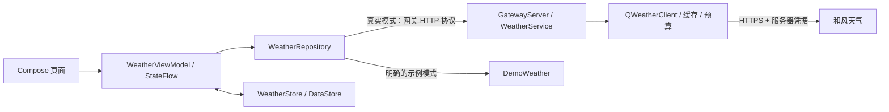

# 技术架构

项目包含两个可独立运行的部分：`app` 是 Android 客户端，`backend` 是 Kotlin/JVM 天气网关。客户端使用 Compose 和单 Activity，网关使用 JDK HttpServer/HttpClient。逐文件职责见 [PROJECT_STRUCTURE.md](PROJECT_STRUCTURE.md)。

## 数据流和责任

页面观察不可变状态并发出操作，不直接解析网络响应或保存偏好。ViewModel 协调仓库与本地存储；仓库在后台线程请求网关，并把取消传递给 OkHttp。Android 和网关之间使用稳定的 JSON 协议，网关负责适配和风当前 API，APK 不包含和风长期凭据。

应用名称为随想天气（ThinkingWeather）。Android 命名空间与正式安装 ID 已统一改为 `com.thinkingweather.android`，网关命名空间为 `com.thinkingweather.gateway`。生产源码位于各模块的 `src/main/kotlin`；JVM 测试与设备测试分别位于 `src/test/kotlin`、`src/androidTest/kotlin`。`version.properties` 当前为版本码 3、名称 1.0.2。调试包使用 `.debug` 后缀，签名分别管理；详细步骤见 [RELEASING.md](RELEASING.md)。

## 客户端状态与存储

首页、城市管理和设置是单 Activity 内独立的全屏 Compose 目的地，使用 AnimatedContent 处理平移、淡入与轻缩放，系统返回与页面返回保持一致。设置返回保留首页滚动位置；选中不同城市后回到顶部。刷新指示器静止时完全隐藏，不保留空白占位；在列表顶部向下拖动时展开，达到阈值显示“松开刷新”，松手触发请求，完成后收起。内容随手势下移，短手势回弹。真实触摸门控避免语义或键盘滚动误置刷新状态，列表中间正常滚动也不触发；另提供无障碍刷新动作。

网络监测只在 Activity 前台注册默认网络回调，去抖后按状态变化显示短 Toast。公网真实请求在无已验证互联网时快速失败。模拟器专用电脑别名和真机 USB 转发都使用电脑网络，允许设备自身没有互联网。连接本机网关失败和互联网离线使用不同提示。

WeatherCategory 作为图标与背景共用的分类入口，优先识别雷雨、冰雹、雨夹雪等组合，避免雪被当成雨或阴天误绘太阳。24 个固定城市样例覆盖全部视觉类别和主要雨雪强度；示例昼夜固定，天气效果不随实际时间改变。

`WeatherUiState` 集中保存当前城市、天气快照、刷新/搜索状态、错误、温度单位和数据模式。切换城市或模式时取消旧工作，并用递增代次避免已经返回的旧请求覆盖当前选择。搜索采用 350 ms 防抖并取消前一个搜索。收藏、单位和模式的持久化按顺序执行，DataStore 的编辑操作保证单次更新原子性。

真实收藏最多 30 座城市；最近快照最多 60 份，并以城市和演示/真实模式组合区分。DataStore 名称为 `thinking_weather_v1`。本次更名变更安装 ID，系统为新应用创建独立存储，不自动读取更名前应用的城市收藏、偏好或缓存。读取真实缓存时立即标记为临时缓存并后台刷新，避免启动时把旧预警呈现为当前信息。示例目录使用固定城市和天气类型，与真实收藏、选择分别管理；每次示例请求直接生成当前固定场景，不再读取旧演示缓存。真实请求失败只保留已有真实缓存和错误，不会改用样例。

缺失数据保持缺失，界面显示占位或未提供。污染物浓度保留提供方单位，不统一假定为 μg/m³；紫外线卡片明确展示每日最高值。页面按城市时区显示日期，区分接口获取时间与气象观测时间。过期预警不展示；缓存预警有明确标记，未知有效期的缓存预警不被当作活动预警。

## 权限与网络

正式应用声明互联网、普通网络状态和大致定位权限。仅在用户主动点击当前位置时申请一次大致定位；坐标保留两位小数用于反向查询，不做后台追踪。定位请求在超时、离开前台或城市/模式变化时取消，返回时再确认用户仍处于同一选择。

发布网络配置强制 HTTPS、系统证书校验并禁止网关地址中内嵌账号、查询和片段。调试版只为 localhost、127.0.0.1、::1 和模拟器的 10.0.2.2 开放 HTTP。仓库先验证配置的 HttpUrl，再仅对 debug 模拟器的 HTTP 回环主机改写为 10.0.2.2，保留端口和编码路径；真机继续使用原回环地址与 adb reverse。公开 HTTPS 地址和 release 地址不改写。这样模拟器重新启动后不依赖临时 adb 转发，电脑后端仍需持续运行。Android 17 的开发网关请求有本地网络授权检查，该权限仅声明在 debug 清单，并在真实模式需要访问时申请。正式公开 HTTPS 网关不使用这一调试权限。

本地配置、天气凭据、密钥库、签名密码不属于源码。Android 配置的是自己的公开网关地址；API Key 或 JWT 私钥由服务器配置提供。系统备份与设备迁移被关闭/排除，本地偏好和缓存留在应用私有存储中。

## 网关聚合与失败边界

`GatewayServer` 暴露 `/health`、`/v1/cities` 和 `/v1/weather`。输入由 `Validation` 校验，路径由程序固定；客户端不能指定上游 URL。上游主机只接受开发者专属 `*.qweatherapi.com`，请求使用 HTTPS 并拒绝重定向。

`WeatherService` 解析 Location ID 或坐标，再并发获取实时、24 小时和 7 日天气，预警与空气质量是可独立降级的数据源。核心天气缺失会返回错误；可选源故障通过 `partialFailures` 表达。默认使用当前坐标型 v1；旧账户若确有需要，可显式选择 v7，不在出错后自动切换并重复请求。

`WeatherMapping` 转换字段、已知单位与日期，合并来源和许可声明，并过滤取消及被替代的预警。当前 API 未提供的观测时间不伪造；聚合的 `fetchedAt` 与 `cacheAgeSeconds` 表示获取/缓存年龄，`stale` 表示过期复用。

上游访问共用有界 LRU 缓存，同一查询的并发缺失只加载一次，失败后短暂冷却。天气和空气质量只能在规定窗口内使用过期缓存；预警不使用过期兜底。入站工作池、队列、同时处理的请求数、每个连接端和全局请求频率都有边界；上游另有每分钟预算。压缩响应最多 512 KiB，解压后最多 1 MiB；完整上游响应有超时。数值和部署调优见 [backend/README.md](../backend/README.md)。

这些限制按单个服务进程生效，默认按实际 socket 对端限流，不信任任意 `X-Forwarded-For`。公开部署仍需 HTTPS 入口、可信代理策略、用户/设备授权、额度预算和运行监控；没有把 Key 放进 APK 并不等于网关已经能识别合法客户端。

## 构建和交付

Gradle 运行环境为 JDK 25，Android 与网关字节码目标均为 JVM 17；客户端最低 Android 8.0（API 26），compile/target SDK 37。固定版本与发行包校验由 Kotlin DSL 和 Gradle Wrapper 管理。

根工程同时验证两个模块；后端自带独立 `settings.gradle.kts`，保留根 Wrapper 与 `version.properties` 即可在没有 Android SDK 的环境构建。Android 和后端共用 `VERSION_NAME`，避免客户端版本与服务端分发包版本脱节。CI 执行 JVM 测试、Lint、应用构建和后端分发包构建。设备上的 Compose 测试以及实际账户联调另行记录，结果见 [VALIDATION.md](VALIDATION.md)。

发布证书由本机签名配置或 CI 环境变量提供，仓库只保留模板和生成脚本；脚本拒绝覆盖已有密钥。`assembleSignedRelease`、`bundleSignedRelease` 先要求完整签名配置，分别输出 APK/AAB。缺少私有配置的公开仓库仍可构建 debug 和未签名 release，不会回退到调试证书假冒正式签名。本次更名只将密钥别名改为 `thinkingweather-release`，保留原私钥、证书及其 SHA-256 指纹；证书主体中的旧名称属于历史签名身份。安装 ID 改变后属于独立应用，不能以覆盖安装迁移原应用数据。

旧 Java Activity、XML 页面、LitePal、自动缩放、图表库与旧和风 SDK 不再参与当前业务链路。清理时，旧 SDK、图片和 APK 曾从工程路径移入被忽略的 `local-archive/legacy/` 本地归档；更名检查时归档目录已不存在，旧文件表仅保留历史记录，不进入当前构建。Git 忽略、解除跟踪、归档和清除历史是不同操作，不能用 `.gitignore` 掩盖已经提交过的秘密。

## 当前范围

当前实现不含后台定位、地图 SDK、账户、推送、雷达或分钟级降水预报。旧 LitePal 收藏不自动迁移。正式对外分发必须使用生产网关和稳定的发布证书，并补齐运营者信息；新增账户或推送时，应先设计真实的身份、授权和数据删除流程，再扩展接口与客户端页面。
