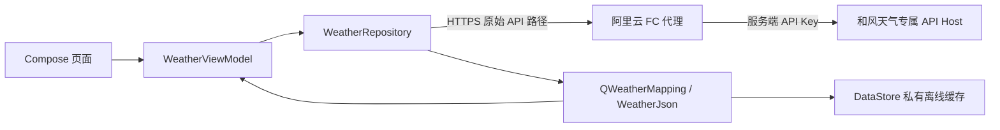

# 架构与数据边界

## 运行链路

1.1.0 仅保留 Android Gradle 模块。原 Kotlin 后端、Docker 部署和本地连接脚本已退出活跃工程；本机归档不属于分发文件。调试版和正式版共用 HTTPS 公网链路，均无 HTTP 例外、模拟器地址改写或本地网络权限。自动化测试使用不进入 APK 的夹具。

## Android 数据层

`WeatherRepository` 请求云函数代理的官方原始路径，优先使用坐标型 Weather v1。城市查询使用 GeoAPI，收藏卡片只查询当前天气；完整天气由实况、小时、每日与可选空气/预警/生活指数响应组合，不再请求旧 `/v1/weather` 聚合协议。

`QWeatherMapping` 把 v1 的嵌套测量值、分数和 m/s 等单位转成客户端稳定模型，同时兼容可用的旧 v7 数据。只有能确定的单位才转换，缺失值保持缺失。获取时间不冒充观测时间，空气污染物保留各自单位及来源标准，生活指数的序数等级不作为实测 UV。

实况失败作为天气查询失败并停止后续请求；小时、每日及可选接口失败记录为 `partialFailures`，保留已取得的实况，无权限或无覆盖不补造建议。客户端同时识别 HTTP 错误及旧代理 HTTP 200 内的和风 `code`。429 触发共享短暂停顿并尊重 `Retry-After`，不通过换接口立即绕过限流。接口兼容切换仅针对明确不支持的 v1 情况，不用于认证、限流或普通网络失败。

网络请求有超时、响应大小限制、取消和并发边界。进程内有界缓存与请求合并减少重复开销；设备缓存过期复用标记为旧数据，预警不使用过期兜底。云端新代理的可选 `Age` 头可回推源缓存年龄，旧代理缺少该头时保持兼容。

`WeatherJson` 是稳定模型与 DataStore 的编解码边界。`WeatherStore` 原子保存城市顺序、当前选择和最后定位城市标记，以及有限数量的完整天气快照；升级时忽略旧示例模式偏好。`CitySummaryStore` 单独保存最多 30 条轻量当前天气摘要，不用摘要覆盖完整预报。城市页仅在前台以最多两个并发请求更新，页面关闭或进入后台时取消这组更新。

`AdministrativeNames` 使用 Java resources 中的固定行政名称表，按省、父级和唯一匹配作保守补全；无法判定时保留和风名称，不修改 ID、坐标或天气覆盖。

## 状态、定位与交互

Weather v1 的实况可能没有观测时间并使用统一条件代码；`WeatherDaylight` 根据城市时区及对应日期日照判定当前昼夜，小时预报则使用各自预报时间。缺失有效日照时按城市当地时间兜底，不使用手机时区把海外或晚间天气画成白天。

ViewModel 负责请求代次、取消、持久化和错误分类；旧请求不能覆盖新选择。定位仅在用户主动请求时获取大致位置，坐标保留两位小数用于反向查询。定位选城在同一可取消任务内执行，成功状态在第一次持久化前原子发布，IO 完成后不再迟到修改定位提示。

城市、选择和位置标记写入同一 DataStore 事务。批量删除至少保留一座城市；重排只接受现有身份，并保留编辑期间新出现的城市。手柄长按抬升、相邻平滑让位、边缘自动滚动及无障碍上下移共享同一顺序状态。

主页与城市/搜索/设置/隐私/关于/天气详情为全屏页面。固定顶部栏与滚动区域分离，API 31+ 使用 GPU 模糊，旧版使用渐变遮罩。刷新必须由顶部的真实触摸下拉、达到阈值并松手触发；语义滚动不会误触发。

详情页消费同一天气快照，不额外请求另一组天气。可用数据决定分区；点击入口定位到对应分区，标签与滚动同步。温度曲线、独立降水柱图和比例环图分别使用明确量纲；不把不同污染物浓度合成虚假的占比或健康总分。

## FC 代理的部署边界

1.2.0 采用 Compose 共享边界连接城市卡片与主页；城市编辑使用固定布局、一次长按触感和弹簧缩放。移动流量提示的已显示标记保存在本机 SharedPreferences，后台往返、Activity 重建或进程重启均不重复，离线提示仍由前台监听决定。

地图是用户主动打开的官方 HTTPS WebView 页面，与 FC 天气数据链路分离，不持有 Key、不接收原生位置、不提供 JS 桥。网页不在首页预加载，退出后销毁；安全导航与生命周期见 [WEATHER_MAP.md](WEATHER_MAP.md)。

`serverless/index.mjs` 是新增的替换实现，保持 `QWEATHER_KEY` / `QWEATHER_HOST` 名称和 raw API 契约。只有在阿里云重新部署后，下列实现才作用于线上服务：

- 固定 HTTPS 专属 Host、GET 路由及参数白名单，不转发调用者认证/任意 URL，拒绝重定向。
- 上游超时及响应读取上限；HTTP/业务错误保留错误语义，错误正文不包含凭据、Host 或内部堆栈。
- 有界 LRU、相同请求合并、失败短冷却、429 的实例级全路径暂停；预警不缓存。
- 实例入站/直接对端/上游预算；默认不启用网页 CORS，原生 Android 不依赖 CORS。

所有 Map、缓存和计数仅属于单个实例，扩容和冷启动不会共享它们。需要在云端入口配置全局配额、预算告警及适用的用户授权；APK 固定 token 和 CORS 都不是保密身份。具体限额、部署和事件格式见 [serverless/README.md](../serverless/README.md)。

## 构建与验证

Gradle 运行于 JDK 25，Android 字节码为 JVM 17；最低 API 26，compile/target 37。`version.properties` 统一版本，签名任务只读取私有配置，不自动替换发布身份。

CI 执行 Android 单元测试、Lint、debug/release 构建及隔离 Node 测试，不调用真实天气、不上传密钥、不部署云函数。设备测试与真实云端验证需单独记录，结果以 [VALIDATION.md](VALIDATION.md) 为准。
