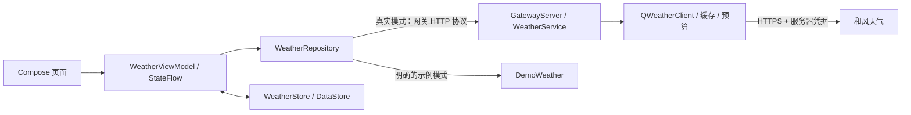

# 技术架构

项目包含两个可独立运行的部分：`app` 是 Android 客户端，`backend` 是 Kotlin/JVM 天气网关。客户端使用 Compose 和单 Activity，网关使用 JDK HttpServer/HttpClient。逐文件职责见 [PROJECT_STRUCTURE.md](PROJECT_STRUCTURE.md)。

## 数据流和责任

页面观察不可变状态并发出操作，不直接解析网络响应或保存偏好。ViewModel 协调仓库与本地存储；仓库在后台线程请求网关，并把取消传递给 OkHttp。Android 和网关之间使用稳定的 JSON 协议，网关负责适配和风当前 API，APK 不包含和风长期凭据。

应用名称为随想天气（ThinkingWeather）。Android 命名空间与正式安装 ID 已统一改为 `com.thinkingweather.android`，网关命名空间为 `com.thinkingweather.gateway`。生产源码位于各模块的 `src/main/kotlin`；JVM 测试与设备测试分别位于 `src/test/kotlin`、`src/androidTest/kotlin`。`version.properties` 当前为版本码 5、名称 1.0.4。调试包使用 `.debug` 后缀，签名分别管理；详细步骤见 [RELEASING.md](RELEASING.md)。

## 客户端状态与存储

首页、城市管理、独立城市搜索、设置和天气详情是单 Activity 内独立的全屏 Compose 目的地，使用 AnimatedContent 处理平移、淡入与轻缩放，系统返回与页面返回保持一致。搜索返回城市管理，设置和天气详情返回保留首页滚动位置；选中不同城市后回到顶部。刷新指示器静止时完全隐藏，不保留空白占位；在列表顶部向下拖动时展开，达到阈值显示“松开刷新”，松手触发请求，完成后收起。内容随手势下移，短手势回弹。真实触摸门控避免语义或键盘滚动误置刷新状态，列表中间正常滚动也不触发；另提供无障碍刷新动作。

“隐私”和“关于”为设置下的独立目的地，返回层级为详情 → 设置 → 首页；SaveableStateHolder 保留页面滚动状态。完整来源、数据许可与版本归属集中在“关于”，首页与天气详情底部只保留简短的和风归属文字。返回目标仍保持 48 dp 触摸区域，视觉位置靠近安全边缘。

首页顶部栏独立叠放在滚动列表上方，列表为其保留空间，操作入口不会随内容移出屏幕。`FrostedToolbar` 在 API 31 及以上记录内容绘制层，仅对顶部的小范围覆盖层使用 GPU 模糊与羽化遮罩；API 26–30 使用相同色系的渐变遮罩，不做 CPU 截屏模糊。定位结果提示从首页可见时计约 3 秒，随后淡出并压缩高度；正在定位的进度不使用结果提示的计时。

网络监测只在 Activity 前台注册默认网络回调，去抖后按状态变化显示短 Toast。公网真实请求在无已验证互联网时快速失败。模拟器专用电脑别名和真机 USB 转发都使用电脑网络，允许设备自身没有互联网。连接本机网关失败和互联网离线使用不同提示。

WeatherCategory 作为图标与背景共用的分类入口，优先识别雷雨、冰雹、雨夹雪等组合，避免雪被当成雨或阴天误绘太阳。24 个固定城市样例覆盖全部视觉类别和主要雨雪强度；示例昼夜固定，天气效果不随实际时间改变。

`WeatherUiState` 集中保存当前城市、天气快照、刷新/搜索状态、错误、温度单位和数据模式。切换城市或模式时取消旧工作，并用递增代次避免已经返回的旧请求覆盖当前选择。搜索采用 350 ms 防抖并取消前一个搜索。收藏、单位和模式的持久化按顺序执行，DataStore 的编辑操作保证单次更新原子性。

城市编辑使用 location 身份管理多选和排序，`CityEditing` 的纯计算拒绝一次删光全部城市，删除当前城市时选择剩余列表第一项。拖动手柄支持长按反馈、卡片抬起、相邻位移动画和边缘自动滚动，同时暴露无障碍上移/下移动作；完成或返回时保存排序。排序过滤重复及未知身份，并保留编辑期间新加入的城市。删除后取消相关摘要工作、清理卡片摘要与已失效的定位标记，示例目录在 ViewModel 与界面两层禁止删除和排序。

位置标记只保存最后成功反查到的已保存城市 location，不另存传感器坐标或历史轨迹。当前选择与定位标记独立：手动选择其他城市不会把该城标为定位结果；删除标记对应城市后清除标记。收藏顺序和标记随其余偏好恢复。

城市卡片使用独立的 `CityWeatherSummary`，包含当前温度、图标、获取时间和来源，不可替代完整预报。城市页在前台时先读取最多 30 条持久化摘要及已有完整缓存，再以并发上限 2 更新缺失或超过 120 秒的数据；单个失败不取消其他城市。离开页面、进入后台、切换模式或删除城市时取消相关工作，并校验代次与收藏身份，防止迟到响应写回。摘要存于独立 DataStore `thinking_weather_city_cards_v1`，完整缓存只读取一次，避免逐城重复解析。

搜索将确认离线与在线错误分开：只有前者设置红色服务不可用提示；空结果保留正常空态，服务失败使用中性说明。单个拉丁字母暂缓联网，中文单字仍可检索。搜索返回同 ID 的完整行政名称时更新收藏、当前城市和摘要元数据，旧响应不能覆盖新名称。

独立搜索页的国内、国际热门城市是随包提供的坐标目录，不是联网排名或实时天气；空查询时不发起搜索。国际热门城市在示例模式下不可添加，国内示例仅切换固定场景，不写入真实收藏。

真实收藏最多 30 座城市；最近快照最多 60 份，并以城市和演示/真实模式组合区分。DataStore 名称为 `thinking_weather_v1`。1.0.0 更名时曾变更安装 ID，不自动读取更名前应用的数据；1.0.4 继续沿用随想天气的 ID 与签名配置。读取真实缓存时立即标记为临时缓存并后台刷新，避免启动时把旧预警呈现为当前信息。示例目录使用固定城市和天气类型，与真实收藏、选择分别管理；每次示例请求直接生成当前固定场景，不再读取旧演示缓存。真实请求失败只保留已有真实缓存和错误，不会改用样例。

缺失数据保持缺失，界面显示占位或未提供。污染物浓度保留提供方单位，不统一假定为 μg/m³；空气详情保留 AQI 标准代码、名称及已提供的健康建议。紫外线实况、每日最高值和生活指数的序数等级分别展示，不能互相替代。页面按城市时区显示日期，区分接口获取时间与气象观测时间。过期预警不展示；缓存预警有明确标记，未知有效期的缓存预警不被当作活动预警。

`WeatherInsightsPage` 只消费当前快照，按实际可用数据生成实况、逐小时、单日、天气指标、空气、紫外线、日月和生活分区。首页入口映射到对应分区，无数据的分区不显示，目标不可用时安全回退。`WeatherInsightData` 负责有限数值、单位转换、城市当地时间、图表范围及入口映射的纯计算；`WeatherInsightCharts` 绘制独立坐标与单位的曲线、柱图和百分比环，未知时点保留断线，0 保留为有效测量值。可滚动的小时与日期选择提供逐项数值，图表同时有语义描述。打开详情不重复拉取上游数据。

首页空气质量卡片将 PM₂.₅、PM₁₀ 等已提供浓度放在 AQI 右侧；日出日落下方为生活建议，优先穿衣、防晒和旅游，均取自提供方当日记录。无覆盖或可选服务失败时不填入固定建议。

摄氏格式统一为 ℃，数值和单位可分开排版；风向在网关中转换为“西南偏西风”等名称，客户端兼容旧缓存别名。`SolarWindow` 只在预报日期与城市当地日期一致、日出日落有效时计算白昼进度；夜间不绘制地平线上方的太阳，缺失或异常时间不推算。`SunPath` 以分层光晕和渐变轨迹表达这个示意位置，不承担天文测量精度承诺。

## 权限与网络

正式应用声明互联网、普通网络状态和大致定位权限。仅在用户主动点击当前位置时申请一次大致定位；坐标保留两位小数用于反向查询，不做后台追踪。定位请求在超时、离开前台或城市/模式变化时取消，返回时再确认用户仍处于同一选择。

发布网络配置强制 HTTPS、系统证书校验并禁止网关地址中内嵌账号、查询和片段。调试版只为 localhost、127.0.0.1、::1 和模拟器的 10.0.2.2 开放 HTTP。仓库先验证配置的 HttpUrl，再仅对 debug 模拟器的 HTTP 回环主机改写为 10.0.2.2，保留端口和编码路径；真机继续使用原回环地址与 adb reverse。公开 HTTPS 地址和 release 地址不改写。这样模拟器重新启动后不依赖临时 adb 转发，电脑后端仍需持续运行。Android 17 的开发网关请求有本地网络授权检查，该权限仅声明在 debug 清单，并在真实模式需要访问时申请。正式公开 HTTPS 网关不使用这一调试权限。

本地配置、天气凭据、密钥库、签名密码不属于源码。Android 配置的是自己的公开网关地址；API Key 或 JWT 私钥由服务器配置提供。系统备份与设备迁移被关闭/排除，本地偏好和缓存留在应用私有存储中。

## 网关聚合与失败边界

`GatewayServer` 暴露 `/health`、`/v1/cities`、`/v1/current` 和 `/v1/weather`。输入由 `Validation` 校验，路径由程序固定；客户端不能指定上游 URL。上游主机只接受开发者专属 `*.qweatherapi.com`，请求使用 HTTPS 并拒绝重定向。

`WeatherService` 解析 Location ID 或坐标，再并发获取实时、24 小时和 7 日天气，预警、空气质量与生活指数是可独立降级的数据源。核心天气缺失会返回错误；可选源故障通过 `partialFailures` 表达。默认使用当前坐标型 v1；旧账户若确有需要，可显式选择 v7，不在出错后自动切换并重复请求。

`/v1/current?location=...` 只加载当前天气，返回 `now`、缓存年龄、新鲜度、获取时间和来源。它与完整预报共用当前天气上游缓存、限流和预算，使城市列表不会为每张卡片重复请求小时、每日、空气质量和预警。

`AdministrativeNames` 对城市搜索返回的中国区县显示名作保守补全，使用约 100 KB 的固定行政名称表，按省级范围及父级唯一匹配；已完整的名称保持，地级中心、歧义或未知地区不猜测后缀。它只改显示名称，不修改 Location ID、坐标或天气覆盖。资源是 `uiwjs/province-city-china` 的固定 MIT 快照，不代表实时官方边界数据；来源和许可证随服务端资源保留。

`WeatherMapping` 转换字段、已知单位与日期，合并来源和许可声明，并过滤取消及被替代的预警。当前 API 未提供的观测时间不伪造；聚合的 `fetchedAt` 与 `cacheAgeSeconds` 表示获取/缓存年龄，`stale` 表示过期复用。

生活指数通过 `/v7/indices/1d?type=0` 一次请求所有可用类型，独立于核心天气选择 v1 或 v7，沿用上游预算和请求合并。默认开启，可用 `QWEATHER_ENABLE_INDICES=false` 禁用。缓存 60 分钟，过期后最多额外复用 60 分钟；聚合时再次按首日预报日期过滤，跨日旧建议、重复及不完整记录不展示。`204` 无覆盖返回空数组，失败返回 `indices_unavailable`，禁用返回 `indices_disabled`；不会阻断核心预报。其 `level` 为提供方定义的序数，不能画成百分比或当作实测 UV。新增的风向角度、云量、露点、日夜风况、月升月落等字段按实际提供情况保留；各源的 `refer` 和 `metadata.attributions` 合并进入归属信息。官方接口与覆盖链接见 [后端说明](../backend/README.md)。

上游访问共用有界 LRU 缓存，同一查询的并发缺失只加载一次，失败后短暂冷却。天气和空气质量只能在规定窗口内使用过期缓存；预警不使用过期兜底。入站工作池、队列、同时处理的请求数、每个连接端和全局请求频率都有边界；上游另有每分钟预算。压缩响应最多 512 KiB，解压后最多 1 MiB；完整上游响应有超时。数值和部署调优见 [backend/README.md](../backend/README.md)。

这些限制按单个服务进程生效，默认按实际 socket 对端限流，不信任任意 `X-Forwarded-For`。公开部署仍需 HTTPS 入口、可信代理策略、用户/设备授权、额度预算和运行监控；没有把 Key 放进 APK 并不等于网关已经能识别合法客户端。

## 构建和交付

Gradle 运行环境为 JDK 25，Android 与网关字节码目标均为 JVM 17；客户端最低 Android 8.0（API 26），compile/target SDK 37。固定版本与发行包校验由 Kotlin DSL 和 Gradle Wrapper 管理。

根工程同时验证两个模块；后端自带独立 `settings.gradle.kts`，保留根 Wrapper 与 `version.properties` 即可在没有 Android SDK 的环境构建。Android 和后端共用 `VERSION_NAME`，避免客户端版本与服务端分发包版本脱节。CI 执行 JVM 测试、Lint、应用构建和后端分发包构建。设备上的 Compose 测试以及实际账户联调另行记录，结果见 [VALIDATION.md](VALIDATION.md)。

发布证书由本机签名配置或 CI 环境变量提供，仓库只保留模板和生成脚本；脚本拒绝覆盖已有密钥。`assembleSignedRelease`、`bundleSignedRelease` 先要求完整签名配置，分别输出 APK/AAB。缺少私有配置的公开仓库仍可构建 debug 和未签名 release，不会回退到调试证书假冒正式签名。前次更名只将密钥别名改为 `thinkingweather-release`，保留原私钥、证书及其 SHA-256 指纹；本次仍继续使用，证书主体中的旧名称属于历史签名身份。安装 ID 改变后属于独立应用，不能以覆盖安装迁移原应用数据。

旧 Java Activity、XML 页面、LitePal、自动缩放、图表库与旧和风 SDK 不再参与当前业务链路。清理时，旧 SDK、图片和 APK 曾从工程路径移入被忽略的 `local-archive/legacy/` 本地归档；更名检查时归档目录已不存在，旧文件表仅保留历史记录，不进入当前构建。Git 忽略、解除跟踪、归档和清除历史是不同操作，不能用 `.gitignore` 掩盖已经提交过的秘密。

## 当前范围

当前实现不含后台定位、地图 SDK、账户、推送、雷达或分钟级降水预报。旧 LitePal 收藏不自动迁移。正式对外分发必须使用生产网关和稳定的发布证书，并补齐运营者信息；新增账户或推送时，应先设计真实的身份、授权和数据删除流程，再扩展接口与客户端页面。
